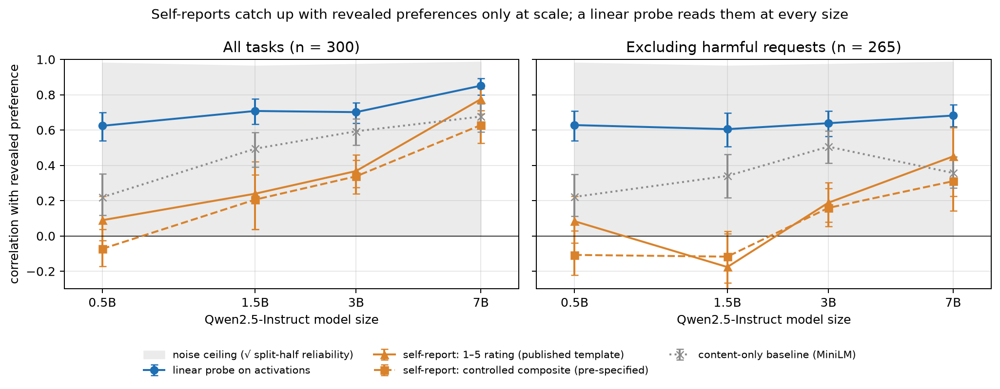

# Self-reports vs. revealed preferences vs. a probe, across model scale

Do language models' self-reports track what they actually choose, and does that change with scale?



Across Qwen2.5-Instruct 0.5B → 7B, on 300 real tasks:

- **Self-reports catch up with revealed preferences only at scale.** Agreement rises from none at 0.5B to
  r ≈ 0.78 at 7B, but much of that comes from models disfavouring harmful requests. On benign tasks alone,
  self-reports carry no signal through 1.5B.
- **A linear probe on activations reads the same preferences at every size.** It reaches r ≈ 0.6–0.7 on benign
  tasks and beats a content-only baseline throughout. The information is present internally well before the
  model can report it.
- **Self-report formats fail basic controls at small scale.** 1–5 ratings ignore which end of the scale means
  "more" until 3B. Negated questions ("would you *dislike* this?") stay dominated by acquiescence through 7B.

See [`WRITEUP.md`](WRITEUP.md) for the full summary and caveats, and [`ladder.ipynb`](ladder.ipynb) for the analysis.

## Design

| measurement | how |
|---|---|
| **Revealed** | Both orders of 2,901 task pairs. The model names *Task A* or *Task B* and completes it, and the choice probability is read from the logits. Utilities come from a Thurstonian model with an explicit position-bias term. |
| **Stated** | 1–5 enjoyment ratings and yes/no questions, with reversed-anchor and negated-question controls. |
| **Probe** | Ridge regression from the last-prompt-token residual stream (50% depth, pre-specified) to revealed utilities, compared with a MiniLM content baseline. |

Tasks are a stratified sample from the canonical test split of Gilg, Beckmann, Paleka & Butlin (2026),
[*Probing Persona-Dependent Preferences in Language Models*](https://arxiv.org/abs/2605.13339). The sources are
WildChat, Alpaca, MATH, BailBench and STRESS-TEST, from
[`oscar-gilg/probing-persona-preferences`](https://github.com/oscar-gilg/probing-persona-preferences) (MIT).

## Reproducing

**Analysis only (no GPU).** All measurements are committed in `results/`. Run the notebook top to bottom. It
detects the results, skips measurement, and regenerates every table and figure.

**Measurement (GPU).** Upload `ladder.ipynb` to [Colab](https://colab.research.google.com), select a **T4 GPU**
runtime, and choose **Run all**. Results save to Google Drive one model at a time, and re-running skips models
that already finished. The full ladder took about 45 minutes on a free T4 (0.5B 2 min, 1.5B 6, 3B 10, 7B 25).
7B is loaded in 8-bit to fit in the T4's memory.

**Without a GPU or results**, the notebook runs a small smoke test (0.5B, 30 tasks) to check that the code works.

## Layout

```
ladder.ipynb        the experiment, generated by build_notebook.py (do not edit by hand)
ladder_core.py      measurement and analysis code, inlined into the notebook
build_notebook.py   regenerates ladder.ipynb from ladder_core.py
results/<model>/    revealed.npy, stated.npz, acts.npy (float16), meta.json for each model
figures/            headline.png, artifacts.png, summary.csv
data/               task data, downloaded on first run (gitignored)
```

To change the experiment, edit `ladder_core.py` or `build_notebook.py`, then run `python build_notebook.py`.

## Environment

```bash
pip install -r requirements.txt
```

On an Intel Mac, PyTorch stops at 2.2.2, which requires `numpy<2` and `transformers<5`. Colab's preinstalled
versions work as they are.
